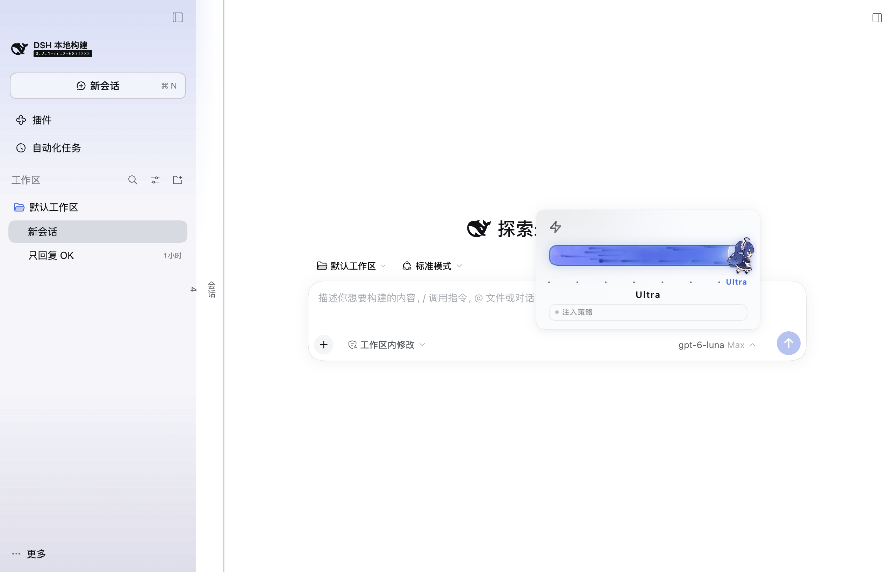
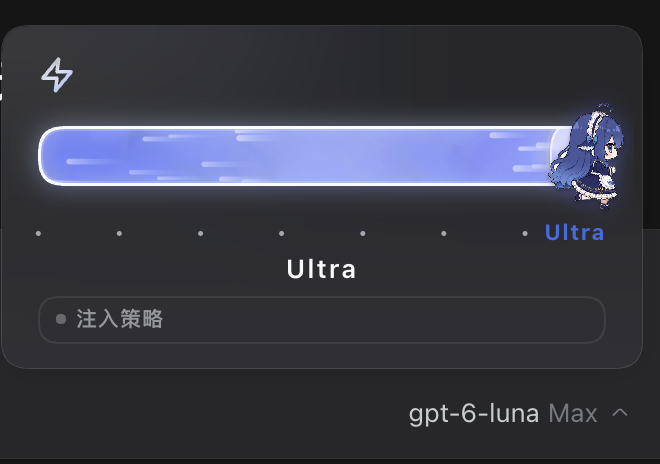
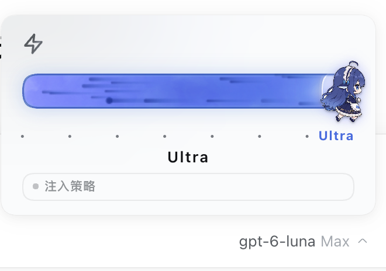
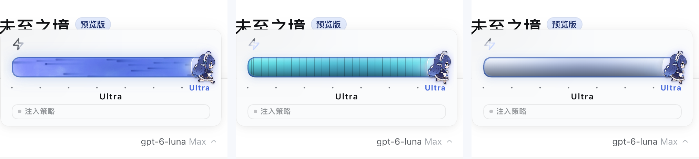

<div align="center">

<!--
  Screenshot placeholders: the verifier generates these images in an isolated
  DSH instance and commits them under assets/readme/. assets/ is not published
  (package.json "files" ships lib/ plus the documentation only).
  hero.png      — README hero: native model entry + effort slider + chibi thumb
  panes-dark.png / panes-light.png — effort pane in dark / light theme
  skins.png     — holo / chrome / fluid energy skins
-->


# dsh-whale-effort

**Keep DeepSeek Harness's native model selector and drag the effort level in its reasoning-effort pane; a chibi whale-girl runner thumb, sci-fi energy skins, an Ultra tier, a lightning orchestration mode and a live subagent tok/s readout.**

[中文](README.md) · [Upstreams and provenance](UPSTREAM.md) · [Third-party notices](THIRD-PARTY.md) · [Changelog](CHANGELOG.md) · [Issues](https://github.com/lxiol-star/deepseek-harness-plugins/issues)

</div>

> This plugin merges the community plugins [`HanaAyane/dsh-reasoning-effort`](https://github.com/HanaAyane/dsh-reasoning-effort) v0.9.0 and [`yuhub233/dsh-effort-slider`](https://github.com/yuhub233/dsh-effort-slider) v1.1.0 (both MIT) and repackages them with this repository's layout and checks. Provenance, changes and licenses are recorded in [UPSTREAM.md](UPSTREAM.md) and [THIRD-PARTY.md](THIRD-PARTY.md).

## What it is

DSH exposes reasoning effort as a dropdown by default. This plugin keeps the native model selector untouched (model list, search, groups and badges stay native) and takes over only its **Effort** pane: the dropdown becomes an energy bar you can click, drag or drive with the arrow keys, with energy skins, an Ultra tier, a lightning orchestration mode and a subagent tok/s readout on top.

- **Levels follow the model**: the count, names and order of levels come from the current model directory's `reasoning.efforts`; there is no fixed three-level set. Models exposing fewer than two levels show a notice and keep the host's original control.
- **Whale-girl slider**: an eight-frame runner replaces the slider button (on by default; called "Big Fat Fish" upstream) and speeds up while dragging; with the system's reduce-motion preference it freezes on a stable frame.
- **Sci-fi energy skins**: `holo` (holographic energy), `chrome` (liquid metal) and `fluid` (fluid, default, with a particle fluid engine and a star trail at the top level); dark and light themes are supported. The Settings row is labelled "Effect skin".
- **Ultra tier**: when a model exposes at least two real levels, one extra `Ultra` stop is appended to the slider. Selecting it still submits the model's **highest real level (MAX)** id — `Ultra` never appears in the model directory.
- **Lightning mode**: a bolt toggle under the slider, on the same row as the subagent tok/s readout (off by default), injects an orchestration policy into the current session: the parent agent only plans, splits boundaries, dispatches subagents concurrently in one message and integrates their results.
- **Subagent tok/s**: the live token throughput of the tracked session's descendants (subagents), shown as full integers without k/M abbreviation; the whole block hides when there is no data.
- **"Injected policy" readout**: a read-only chip showing the exact policy body currently resolved for the session; collapsed by default and shown only when the host resolves a non-empty policy (Ultra or lightning active).
- **Guidance for custom models without levels**: for a custom model declared in `llm-pi-ai` whose levels the directory cannot see, the pane first points at the graphical Settings path; "Advanced configuration" contains YAML generated with the active configuration file's indentation, the file path and entry location, plus a prompt you can copy for an agent. Models with valid levels or explicitly disabled reasoning get no guidance.
- **Bilingual, theme-aware, keyboard accessible, reduce-motion aware**: copy follows DSH's language immediately.

## Screenshots

<!-- Screenshot placeholders: the verifier commits the generated files under assets/readme/. -->

| Dark theme | Light theme |
| --- | --- |
|  |  |

| Energy skins | |
| --- | --- |
|  | Skins are ordered `holo` / `chrome` / `fluid` (default `fluid`); `fluid` has the particle engine and speeds up with a star trail at Ultra. |

## Install

Requires **DSH `0.2.1-rc.2`** (Web or Desktop profile).

> If you previously installed the upstream `dsh-reasoning-effort` or `dsh-effort-slider`, uninstall it first: installing both plugins on the same entry point makes two controls take over the model menu and policy injection.

### Option 1: Release tarball (recommended)

1. Download `dsh-whale-effort-0.1.0.tgz` from [Releases](https://github.com/lxiol-star/deepseek-harness-plugins/releases/tag/dsh-whale-effort-v0.1.0).
2. In DSH, open **Settings → Plugins → Add plugin** and pick the `.tgz`; or run:

   ```sh
   dsh plugin --profile desktop add /absolute/path/to/dsh-whale-effort-0.1.0.tgz
   ```

3. **Fully quit and reopen DSH**: the host and client halves load separately, so refreshing the page does not load new host code.

### Option 2: Install from the GitHub subdirectory

Enter this pinned version in the plugin manager's "package name or address" field:

```text
github:lxiol-star/deepseek-harness-plugins#dsh-whale-effort-v0.1.0&path:/plugins/dsh-whale-effort
```

`plugins/dsh-whale-effort/` in the repository is the complete plugin directory and its `lib/` is already built, so no local build is needed.

## Usage

### Adjust reasoning effort

Open a session, click the model entry next to the composer and choose **Effort**: the slider draws one tick per level of the current model, highlights the current level and shows its name. Click the track or drag the thumb; it snaps to the nearest level on release and the pane stays open. Esc returns, an outside click dismisses, and keyboard arrows work.

### Ultra tier

When the model exposes at least two real levels, the slider gains one extra **`Ultra`** stop:

- Selecting Ultra still submits the model's **real highest level (MAX)** id; Ultra is a display-only stop and never reaches the model directory or the request payload.
- It also injects a "rigor contract" into the current session: define acceptance criteria first, evidence before claims, adversarial review, root-cause first, explicit stop conditions, and never edit tests to fit the implementation.
- Invariant: while the UI sits on Ultra, the submitted effort is always MAX (drag release, tick click and restore-from-host all go through the same write path).
- The name is `Ultra`, not uppercase `ULTRA`.

### Lightning mode

The bolt toggle under the slider, on the same row as the subagent tok/s readout, is **off by default**. Turning it on injects an orchestration policy into the current session: the parent agent only plans, splits, dispatches, reviews and integrates, hands work to subagents by boundary, dispatches them concurrently in one message, and subagents are self-contained and return pointers to artifacts. Turning it off appends an OFF notice so the earlier policy does not keep applying.

The policy body itself is English (same as upstream, since it is an instruction to the model); UI labels follow DSH's language.

> ⚠️ This does not add compute. Ultra and lightning are both **prompt-layer** controls: Ultra changes *how results are accepted*, lightning changes *who does the work*. Lightning is the expensive one — a multi-agent run costs roughly **15×** the tokens of a single agent, which is why it is off by default.

### Subagent tok/s and policy readout

Under the slider sit the bolt toggle and the subagent tok/s readout on the same row; the "Injected policy" chip sits below them.

- **tok/s readout**: the token throughput of the tracked session's descendants (subagents), computed over a 1.5 s window and shown as full integers (`12,840`, not `12.8k`); it hides entirely when there is no data and never shows estimates.
- **"Injected policy" chip**: read-only display of the exact policy body resolved for the current session, collapsed by default and expandable on click; it appears only when the host resolves a non-empty policy (Ultra or lightning active). The policy follows the switches; the plugin never rewrites session history.

### Custom models without levels

If the current model is a custom model you declared in `llm-pi-ai` and the directory cannot see any levels, the effort pane shows configuration guidance:

1. Prefer the graphical path shown at the top: **Settings → Models → Edit provider → Custom settings → Model options (›) → Reasoning effort**;
2. To edit manually, expand "Advanced configuration" for YAML generated with the active configuration file's indentation, the file path and entry location, then fill in the endpoint's actual values;
3. Or click "Copy for agent" to hand a prompt containing the current route, model id, configuration path and entry location to a coding agent.

The plugin is **strictly read-only** and never modifies DSH configuration or the built-in catalog; knowledge-base entries are references only and the endpoint documentation is authoritative.

## Settings

Three options live under **Settings → General settings**:

| Option | Description | Default |
| --- | --- | --- |
| Reasoning effort slider ("Enabled / Disabled" state) | Master switch. Turning it off immediately restores DSH's native model selector without uninstalling; turning it on brings the enhanced slider back. | Enabled |
| Whale-girl slider | Whether the whale girl ("Big Fat Fish" upstream) replaces the slider button (appearance only; snapping, keyboard control and model selection are unchanged). | Enabled |
| Effect skin | `holo` (Hologram) / `chrome` (Liquid metal) / `fluid` (Fluid). Switching applies immediately and persists across DSH restarts. | `fluid` (Fluid) |

The first two switches live in the current browser only; the effect skin is a global preference, while Ultra and lightning state are stored per session on this machine (see "Data and privacy").

## Compatibility

| Item | Notes |
| --- | --- |
| DSH | Target version `0.2.1-rc.2`; `package.json` declares `engines.dsh: ">=0.2.1-rc.2 <0.3.0"`. Web and Desktop profiles share the same Web client. |
| Node.js | `^22.19.0 \|\| >=24.0.0` (build-time only; the plugin installs no runtime dependencies). |
| Models | The slider needs at least two levels in the model directory; Ultra needs a real MAX level. |
| Host interfaces | Uses DSH client services (slots / locale / sessions / model directory) plus the host's `connection` / `webServer`; terminal-only profiles do not load the client half. |
| Platforms | Verified mainly on macOS; Windows / Linux and standalone Web deployments are not systematically verified. |
| Coexistence | Do not install alongside the upstream `dsh-reasoning-effort` / `dsh-effort-slider`. |

The DSH client plugin API is still a release candidate: re-verify after host upgrades. This plugin targets RC versions (not alpha) and does not promise automatic compatibility across RCs.

## Data and privacy

- **No outbound network requests at all** — no telemetry, no analytics, no remote configuration.
- The only persisted file is `$DSH_HOME/storages/dsh-whale-effort.json` (`$DSH_HOME` resolves as explicit configuration → `DSH_HOME` environment variable → `~/.dsh`). It holds a version number, the current skin and `{ lightning, ultra }` for at most the 40 most recently touched sessions; it is replaced atomically through a temp file + rename, and malformed records are normalized to defaults instead of failing plugin load.
- Policy text is appended only to the **tracked session's** next model request (filtered strictly by session id) and only when the resolved text changed; tok/s is computed in process memory from session events only and is never written to disk or reported anywhere.
- Host and client communicate through one loopback route, `POST /dsh-whale-effort/<endpoint>`; the route applies the DSH connection's `requestRejection` fence (Host/Origin and browser-session validation) and registers no unauthenticated route.

## Uninstall

Use **Settings → Plugins** to uninstall, or run:

```sh
dsh plugin --profile desktop remove dsh-whale-effort
```

Then **fully quit and reopen DSH**; the native model selector comes back automatically. Delete `$DSH_HOME/storages/dsh-whale-effort.json` as well if you want the saved preferences gone.

## Development and build

The plugin installs no runtime dependencies; `check` and `build` take `tsc` / `vitest` / `esbuild` from the DSH source checkout named by `DSH_REPO`:

```sh
cd plugins/dsh-whale-effort
export DSH_REPO=/absolute/path/to/deepseek-harness
npm run check    # strict tsc + vitest, fully offline
npm run build    # emits lib/index.js, lib/client.js, lib/types/
npm pack --ignore-scripts
```

- `lib/` is a build artifact (committed to the repository and the only code shipped in the tarball); never edit it by hand, and always rerun `npm run build` after changing `src/`.
- Package layout, host/client split, release procedure and hard rules are in the repository's [plugin development handoff](../../docs/plugin-development-handoff.md).
- Host RPC endpoints: `diagnose`, `store`, `session/state`, `session/update`, `session/policy`.

## Provenance and license

This plugin merges two MIT upstreams:

- **Native-selector integration, whale-girl runner, effort-selection logic, configuration guidance and i18n**: from [`HanaAyane/dsh-reasoning-effort`](https://github.com/HanaAyane/dsh-reasoning-effort) v0.9.0 (MIT © HanaAyane);
- **Energy skins, fluid particle engine, Ultra tier, lightning mode, subagent tok/s and policy texts**: from [`yuhub233/dsh-effort-slider`](https://github.com/yuhub233/dsh-effort-slider) v1.1.0 (MIT © yuhub233);
- Merge, port and packaging code: this repository, Apache-2.0 (© lxiol-star and contributors).

The bolt SVG path comes from [Feather Icons](https://github.com/feathericons/feather) `zap` (MIT © Cole Bemis); the Ultra and lightning policies were designed with reference to [obra/superpowers](https://github.com/obra/superpowers) (MIT, **not redistributed here**). Upstream versions, a change inventory and the full license texts are in [UPSTREAM.md](UPSTREAM.md) and [THIRD-PARTY.md](THIRD-PARTY.md).

## Known limitations

- Ultra and lightning are prompt-layer controls: they add no compute and change no model capability; lightning's multi-agent overhead is roughly 15× a single agent.
- Subagent tok/s only counts descendants of the tracked session within the current process; archived, restarted or no-longer-tracked subagents are excluded, and with no data the block hides instead of showing an estimate.
- Policy injection takes effect on the next step after a switch changes; it never rewrites requests already sent, filters strictly by session id and deduplicates identical text.
- The slider depends on the model directory's `reasoning.efforts`; with no levels or a single level the plugin falls back to the host's behavior and never fabricates levels.
- After install or upgrade you must fully quit and reopen DSH, otherwise a new client can run against an old host.
- The DSH client plugin API is in the RC stage: host upgrades or changes to the official model selector may affect the injection point; re-verify after upgrading.
