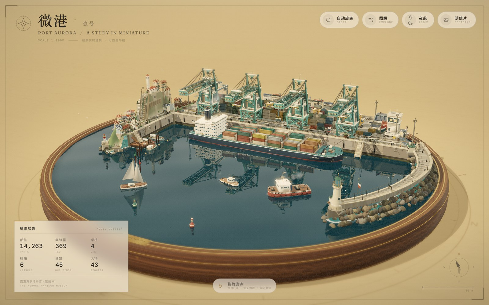

# 微港 · Port Aurora

> 一座可以**自由旋转**的超高精度微缩港口，作为「露港海事博物馆 · 壹号馆藏」呈现。
>
> 胡桃木底座、黄铜嵌线与侧铭牌；展厅柔光下，四台岸桥俯身越过集装箱船 AURORA，
> 场桥与跨运车在堆场里穿行，防波堤尽头灯塔扫过海面，老城沿西山层层叠起，
> 鱼市收摊、拖轮冒烟、海鸥绕塔——全部由代码实时搭建。



这是一个 **DSH Agent Teams 生成的完整产物归档**：由 Lead + 6 个 durable teammate
（terrain-civils / terminal-yard / fleet / town / effects / verifier）协作完成，
源码、提示词、验收记录与全分辨率预览都在本目录。

> 它不是 DSH 插件包，而是放在插件仓库里的**作品 / 案例集**。

---

## 先看这些

| | |
|---|---|
| 日间全景 | [screenshots/hero.jpg](screenshots/hero.jpg) |
| 夜航 | [screenshots/night.jpg](screenshots/night.jpg) |
| 图解标注 | [screenshots/labels.jpg](screenshots/labels.jpg) |
| 船 | [screenshots/ship.jpg](screenshots/ship.jpg) |
| 岸桥 | [screenshots/cranes.jpg](screenshots/cranes.jpg) |
| 老城 | [screenshots/town.jpg](screenshots/town.jpg) |
| 明信片 | [screenshots/postcard.jpg](screenshots/postcard.jpg) |
| 全分辨率明信片 | [screenshots/postcard-full.png](screenshots/postcard-full.png) |
| 移动端 | [screenshots/mobile-hero.jpg](screenshots/mobile-hero.jpg) |

---

## 打开 / 运行

**最快**：直接双击单文件版，完全离线（Three.js 与字体均内联，约 1.5 MB）：

→ [`dist/aurora-harbour-standalone.html`](dist/aurora-harbour-standalone.html)

**完整源码**（可二次修改）：

```bash
cd source
# 双击 index.html，或起静态服务器
python3 -m http.server 8123
# http://127.0.0.1:8123/
# 或重新打包单文件：
node build-standalone.mjs
```

依赖只有仓库内 `source/vendor/three.min.js`（r160）与本地字体；无 npm、无网络请求。

推荐 Chrome / Edge / Safari（WebGL2）。

---

## 互动

| 操作 | 效果 |
|---|---|
| 拖拽 | 360° 自由环视（带惯性），俯仰 7°–66° |
| 滚轮 / 双指捏合 | 缩放；双击回到初始视角 |
| 空格 / 自动旋转 | 暂停 / 恢复缓慢自转 |
| L / 图解 | 打开 13 条部件图解（岸桥、集装箱船、灯塔、老城、鱼市……） |
| N / 夜航 | 展厅熄灯，模型灯亮起 |
| P / 明信片 | 导出作品集明信片 PNG |
| R | 回到初始视角 |

尊重 `prefers-reduced-motion`；移动端自动切换 portrait 构图与控件。

---

## 这一版做了什么

- **14,263 个程序化部件**：4 台可动 STS 岸桥（吊具/小车/钢缆动画）、369 只实例化集装箱、
  2 台场桥、3 台跨运车、3 台集卡、正面吊、叉车、动态调车机车。
- **6 艘船**：集装箱船 AURORA（放样船体、109 只甲板箱、6 根系缆、旋转雷达、救生艇）、
  拖轮 MISTRAL、巡航巡逻艇（尾迹 + 泡沫）、3 艘渔船、帆船、红绿航道浮标与系泊浮标。
- **海港地形与工程**：岛屿海岸线、分层岩壁、码头岸壁与系缆柱、防波堤/扭工字块、
  多段石阶与挡土墙、浮桥、滑道、灯塔 + keeper hut。
- **老城**：33 栋台地民居、教堂钟楼（两面钟）、广场喷泉、鱼市、咖啡露台、仓库后街、
  43 个人物（8 个行走）、51 棵树、18 台车、路灯/长椅/自行车/彩旗。
- **水面**：自定义水体 shader + 半分辨率平面反射、岸线泡沫、太阳高光、夜间灯光碎影。
- **展厅**：胡桃木车削底座 + 黄铜嵌线 + 侧铭牌；ACES + 轻泛光 + 移轴 + 暗角/颗粒。
- **易用性**：13 条登记图解（桌面最多 12 张自适应）、昼/夜、明信片导出、移动端自适应、减少动态偏好。

### 性能与验收

| 指标 | 结果 |
|---|---|
| 自动验收 | **66 pass / 3 warn / 0 fail** |
| 帧率 | **60 fps** day / night（1400×900 dpr1.25 与 1600×1000 dpr1.5） |
| draw calls / tris | 325 / 489,466 |
| 平台 | Apple M4 Pro · ANGLE Metal · Chrome |
| 运行错误 | 页面无错误，`buildErrors: []` |
| 离线 | 100% `file:` / `data:` 资源；双击字体正常 |
| 移动端 | 430×900 全 plinth 构图、labels 无重叠、postcard 版式通过 |

两条非阻塞 warning：draw calls 325（自设 220 目标，但 60 fps 稳定）；移动端后期对比度
0.71×（bloom 在纸色背景上的轻微雾感）。详见 `docs/QA.md`。

---

## 团队与提示词

| 成员 | 职责 |
|---|---|
| **Lead** | 坐标契约、底座/展厅/水体/后期/UI、组装、验收、归档 |
| `terrain-civils` | 岛屿、岸线、岸壁、防波堤、灯塔、道路/铁路、挡土墙与硬质景观 |
| `terminal-yard` | 4 台岸桥、集装箱堆场、场桥、终端建筑、铁路调车 |
| `fleet` | 集装箱船、拖轮、巡逻艇、渔船、帆船、浮标与系泊 |
| `town` | 老城、鱼市、教堂、后街仓库、人物、树、车与街道家具 |
| `effects` | 海鸥、烟、灯塔光束、航标、浮尘、旗帜 |
| `verifier` | QA harness、截图矩阵、交互/性能/视觉评审、最终 gate |

- [提示词档案](prompts/) — 用户简报、Lead 编排、6 个 teammate spawn prompt、追改日志
- [坐标与 API 契约](docs/CONTRACT.md) / [布局设计](docs/LAYOUT.md)
- [QA 矩阵](docs/QA.md) / [问题与优先级](docs/CRITIQUE.md)
- [机器可读 report](qa/report.json)

---

## 目录

```text
agent-team-port-aurora/
├── README.md
├── THIRD_PARTY_NOTICES.md
├── manifest.json
├── prompts/                 # 原始提示词 & 追改记录
├── docs/                    # 坐标/契约/QA 文档
├── source/                  # 可运行源码（index.html + js + vendor）
├── dist/                    # 单文件离线版
├── screenshots/             # 压缩画廊 + 全分辨率明信片
├── qa/                      # report.json + QA 工具
└── licenses/                # Three.js MIT / 字体 OFL 文本
```

## 许可

本产物作为本仓库的一部分，遵循仓库的 [Apache-2.0](../../LICENSE)（除非另有说明）。
三方依赖与字体的许可见 [THIRD_PARTY_NOTICES.md](THIRD_PARTY_NOTICES.md)：
Three.js（MIT）、Fraunces（OFL-1.1）、DM Mono（OFL-1.1）。

---

*Generated with DeepSeek Harness Agent Teams · 2026-11-08/09 · Port Aurora, a study in miniature.*
